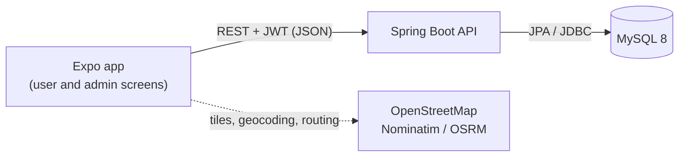

# 🚌 MetroWare

**A full-stack bus transit platform: discover routes, plan a trip to the nearest stop, book and pay for tickets, and manage the whole network from an admin console.**


> Built as a semester project for the **Database Management Systems (DBMS)** course.
> The focus is on a properly designed relational database (ER modelling, 3NF, constraints,
> transactions) backed by a secure REST API and a cross-platform mobile / web client.

---

## 📑 Table of contents

1. [Features](#-features)
2. [Tech stack](#-tech-stack)
3. [Architecture](#-architecture)
4. [Database design](#-database-design)
5. [Security](#-security)
6. [API overview](#-api-overview)
7. [Project structure](#-project-structure)
8. [Getting started](#-getting-started)
9. [Configuration](#-configuration)
10. [Testing](#-testing)
11. [Concepts and learnings](#-concepts-and-learnings)
12. [Known limitations and roadmap](#-known-limitations-and-roadmap)
13. [Author](#-author)

---

## ✨ Features

### Passenger (user)
- **Sign up / log in** with JWT-based sessions; edit profile and change password
- **Browse routes** on an interactive map with all stops and the buses serving each route
- **Nearest route planner**: enter a start and a destination (by place name); the system finds the best
  route, the stop to board and get off at, the walking distance on both ends, and the bus numbers
- **Book tickets**: pick bus, pickup and drop stop, quantity; the **price is calculated by the server**
- **Pay by cash or Easypaisa** (simulated gateway) and view every ticket with its payment status
- **Complaints** and **Lost & Found** boards (create, edit your own posts)

### Administrator
- **Dashboard** with live counts (users, routes, tickets, complaints, lost & found)
- **Route management**: create / edit / delete a route with its stops and number of buses in one form;
  bus numbers (e.g. `GL-01`, `GL-02`) are generated automatically
- **Ticket console**: all bookings, search, per-bus summary, and **mark a cash booking as paid**
- **Moderation**: view and delete any complaint or lost & found post
- **User list** with per-user activity (tickets, complaints, posts)

---

## 🧰 Tech stack

| Layer | Technology |
|---|---|
| **Mobile / Web client** | React Native 0.88, React 19, **Expo** (SDK 58) with **Expo Router** (file-based routing), TypeScript |
| **Maps and geo** | Leaflet in a `react-native-webview`, OpenStreetMap tiles, **Nominatim** (geocoding), **OSRM** (road routing) |
| **Client storage** | `expo-secure-store` (native) / `localStorage` (web) for the session token |
| **API** | **Java 21**, **Spring Boot 4.0.9** (Spring Web MVC), Spring Data JPA (Hibernate), Spring Security, Bean Validation |
| **Auth** | **JWT** (jjwt 0.12), **BCrypt** password hashing, role-based access control |
| **Database** | **MySQL 8.0** (InnoDB), plain-SQL schema with constraints |
| **Build / tooling** | Maven (wrapper), Lombok, Git, Postman, MySQL Workbench, VS Code |

---

## 🏛 Architecture



**Backend layers** (each request flows top to bottom):

```
Filters      HttpsEnforceFilter -> RateLimitFilter -> JwtAuthFilter (Spring Security chain)
Controller   HTTP only: routing, @Valid request bodies, current user
Service      business rules, authorization checks, @Transactional units of work
Repository   Spring Data JPA (queries, bulk operations)
Entity / DB  JPA entities mapped to tables created by db/schema.sql
```

**Frontend layers:** `app/` (screens, routing) → `components/` (reusable UI) → `services/` (API calls, one file per domain)
→ `services/api.ts` (single `fetch` wrapper that adds the token, parses errors, and logs out on an expired session).

**Design decisions**
- **DTOs everywhere**: entities are never returned directly (no password hashes or internal fields leak).
- **The server owns the rules**: fares, bus numbering, nearest-route planning, payment status, and user roles
  are decided on the server, never trusted from the client.
- **Single source of truth for the schema**: `db/schema.sql` creates the database (`ddl-auto=none`),
  so the SQL (not an ORM) defines keys, constraints, and indexes.

---

## 🗄 Database design

The schema is in **Third Normal Form (3NF)** and is defined in [`backend/db/schema.sql`](backend/db/schema.sql).

```mermaid
erDiagram
    USERS ||--o{ BOOKINGS : makes
    USERS ||--o{ COMPLAINTS : files
    USERS ||--o{ LOST_FOUND_THINGS : posts
    ROUTES ||--o{ ROUTE_STOPS : "has"
    STOPS ||--o{ ROUTE_STOPS : "appears in"
    ROUTES ||--o{ BUSES : operates
    BUSES |o--o{ BOOKINGS : "used for"
    STOPS |o--o{ BOOKINGS : "pickup / drop"
    BOOKINGS ||--o{ TICKETS : contains
    BOOKINGS ||--|| PAYMENTS : "paid by"

    USERS {
        int user_id PK
        string user_email UK
        string user_role
    }
    ROUTES {
        bigint route_id PK
        string route_name UK
    }
    STOPS {
        bigint stop_id PK
        string stop_name
        double latitude
        double longitude
    }
    ROUTE_STOPS {
        bigint route_id PK, FK
        bigint stop_id PK, FK
        int stop_order
    }
    BUSES {
        bigint bus_id PK
        string bus_number UK
        bigint route_id FK
    }
    BOOKINGS {
        bigint booking_id PK
        int user_id FK
        bigint bus_id FK
        int unit_price
    }
    TICKETS {
        bigint ticket_id PK
        bigint booking_id FK
    }
    PAYMENTS {
        bigint payment_id PK
        bigint booking_id FK, UK
        string payment_method
        string payment_status
    }
```



### Normalization highlights
| Problem in the first design | Fix |
|---|---|
| A route stored its own `start_stop` / `end_stop`, derivable from its stops (update anomaly) | Removed. They are **derived** from `route_stops` |
| A stop belonged to exactly one route, so the same place was stored many times | `stops` holds each physical place once; **`route_stops` is a junction table** for the **many-to-many** relation, with the order on the route |
| One `tickets` row mixed ticket, booking, and payment facts (2NF / 3NF violation) | Split into **`bookings`** (the trip), **`tickets`** (one per passenger), and **`payments`** (one per booking) |

**Intentional denormalization:** `bookings` stores a *snapshot* of the bus number, route name, and stop names, so a
ticket stays correct even after the route is renamed or deleted (historical record).

### Constraints and referential rules
- **Primary keys** on every table; composite PK `(route_id, stop_id)` on `route_stops`
- **UNIQUE:** user email, route name, bus number, stop place, `(route_id, stop_order)`, payment per booking, transaction id
- **CHECK:** role in (`user`, `admin`), coordinate ranges, `unit_price > 0`, `amount > 0`, payment method/status values,
  *paid ⇔ `paid_at` is set*, *an Easypaisa payment must have a transaction id*, no blank text
- **ENUM:** `lost_found_things.item_type` (`LOST`, `FOUND`)

| Relationship | `ON DELETE` | Why |
|---|---|---|
| `route_stops → routes` | `CASCADE` | Deleting a route removes its stop links |
| `route_stops → stops` | `RESTRICT` | A stop used by a route cannot be deleted |
| `buses → routes` | `SET NULL` | The bus survives when its route is removed |
| `bookings → buses / stops` | `SET NULL` | History survives (names are snapshotted) |
| `bookings → users` | `RESTRICT` | A user with bookings cannot be deleted |
| `tickets`, `payments → bookings` | `CASCADE` | They have no meaning without the booking |

### Transactions (ACID)
Booking a ticket creates a `bookings` row, a `payments` row, and N `tickets` rows inside **one `@Transactional`
method**. If any step fails, everything is rolled back. Route create/update (route + stops + buses) is atomic in the
same way. A runnable demo is in [`backend/db/transaction_demo.sql`](backend/db/transaction_demo.sql).

### Indexes
Foreign-key indexes plus `bookings(user_id, booked_at)`, `route_stops(stop_id)`, `buses(route_id)`,
`complaints(complaint_date)`, `lost_found_things(item_type, date)`.

---

## 🔐 Security

| Area | What is implemented |
|---|---|
| **Authentication** | Stateless **JWT** (24 h); passwords hashed with **BCrypt** |
| **Authorization** | Role-based URL rules (`/api/admin/**` is admin only; route/stop/bus changes are admin only) **plus** ownership checks in the service layer (only the author edits a complaint; author or admin deletes) |
| **Privilege escalation** | The role is **never** read from a request; new accounts are always `user` |
| **Input validation** | Bean Validation on every request body; DB `CHECK` constraints as a second line of defense |
| **Price integrity** | Fares are computed on the server; payment status can only change through server code |
| **Brute-force protection** | Per-IP rate limit on login (10/min) and signup (5/min); an account is locked for 15 min after 5 failed logins |
| **User enumeration** | Same error for wrong email and wrong password, and a dummy hash check to equalize response time |
| **CORS** | Allow-list of origins (not `*`) |
| **HTTPS** | `REQUIRE_HTTPS=true` rejects plain HTTP (use behind a TLS proxy such as Caddy / Nginx / a PaaS) |
| **Secrets** | DB credentials, JWT secret, and admin password come from environment variables / a git-ignored `.env`; the app refuses to start with a weak JWT secret |
| **Least privilege** | The app can use a MySQL user with only `SELECT, INSERT, UPDATE, DELETE` (no `DROP` / `ALTER`) |
| **Error hygiene** | Internal exception details and SQL are never sent to the client |

---

## 🔌 API overview

Base URL: `http://localhost:8080/api`. Send `Authorization: Bearer <token>` on all routes except `/auth/*`.
Errors are JSON: `{ "message": "..." }`.

| Method | Endpoint | Access | Purpose |
|---|---|---|---|
| POST | `/auth/signup`, `/auth/login` | Public | Create account / get token |
| GET, PUT | `/users/me` | User | View / update own profile |
| PUT | `/users/me/password` | User | Change password |
| GET | `/routes`, `/routes/{id}`, `/routes/{id}/stops` | User | Browse routes and stops |
| GET | `/routes/plan?fromLat&fromLng&toLat&toLng` | User | Nearest-route planner |
| POST, PUT, DELETE | `/routes`, `/routes/{id}` | **Admin** | Manage routes (stops and buses included) |
| GET | `/stops`, `/stops/route/{routeId}` | User | Stops |
| GET | `/buses` | User | Buses |
| DELETE | `/buses/{id}` | **Admin** | Remove a bus |
| GET | `/tickets/quote?pickupStopId&dropStopId&quantity` | User | Server-side price quote |
| POST | `/tickets` | User | Book tickets (cash or Easypaisa) |
| GET | `/tickets/my` | User | My tickets |
| GET | `/admin/tickets` | **Admin** | All tickets |
| PUT | `/admin/tickets/booking/{bookingId}/paid` | **Admin** | Mark a cash booking as paid |
| GET | `/admin/users` | **Admin** | All users |
| GET, POST | `/complaints`, `/lost-found` | User | List / create |
| PUT | `/complaints/{id}`, `/lost-found/{id}` | Owner | Edit own post |
| DELETE | `/complaints/{id}`, `/lost-found/{id}` | Owner or Admin | Delete |

**Business rules:** fare is **Rs 80** for trips up to 15 km (straight-line distance, Haversine) and **Rs 120** beyond;
1 to 10 tickets per booking; pickup and drop must be different stops on the bus's route.

---

## 📁 Project structure

```
metroware/
├── backend/
│   ├── db/
│   │   ├── schema.sql              # full database (tables, constraints, indexes)
│   │   ├── seed.sql                # optional sample routes, stops, buses
│   │   └── transaction_demo.sql    # ACID rollback / commit demo
│   ├── .env.example                # configuration template
│   ├── pom.xml
│   └── src/main/java/net/original/metroware/
│       ├── Controller/             # REST endpoints
│       ├── Service/                # business logic and transactions
│       ├── Repository/             # Spring Data JPA repositories
│       ├── Entity/                 # JPA entities (one per table)
│       ├── dto/                    # request / response objects
│       ├── security/               # JWT service and filters, rate limiter, HTTPS filter
│       ├── exception/              # ApiException, global error handler
│       ├── confiq/                 # security / CORS config, default-admin seeder
│       └── util/                   # GeoUtils (Haversine)
└── frontend/
    └── src/
        ├── app/                    # Expo Router screens: (user)/, (admin)/, login, signup
        ├── components/             # TicketCard, RouteMap, NearestMap, Dropdown, ...
        ├── services/               # api.ts + one service per domain
        ├── context/                # AuthContext (session state)
        ├── types/                  # shared TypeScript types
        └── utils/                  # storage, formatting, helpers
```

---

## 🚀 Getting started

### Prerequisites
- **JDK 21**
- **MySQL 8.0.16 or newer** (earlier versions parse but do not enforce `CHECK` constraints)
- **Node.js** (LTS) and npm
- A phone with **Expo Go** or an Android / iOS emulator (or a browser for the web build)

### 1. Clone
```bash
git clone <your-repo-url>
cd metroware
```

### 2. Create the database
Run the schema as a MySQL admin user (this **drops and recreates** all tables):
```bash
mysql -u root -p < backend/db/schema.sql
mysql -u root -p < backend/db/seed.sql        # optional sample data
```

*(Recommended)* create a restricted user for the application:
```sql
CREATE USER 'metroware_app'@'localhost' IDENTIFIED BY 'a-strong-password';
GRANT SELECT, INSERT, UPDATE, DELETE ON metroware.* TO 'metroware_app'@'localhost';
```

### 3. Configure and run the backend
```bash
cd backend
cp .env.example .env          # then edit the values (see Configuration)
./mvnw spring-boot:run        # Windows: mvnw spring-boot:run
```
Generate a JWT secret:
```bash
node -e "console.log(require('crypto').randomBytes(48).toString('base64'))"
```
On first start a default admin is created: **`admin@test.com`** with the password from `ADMIN_PASSWORD`.

### 4. Run the frontend
```bash
cd frontend
npm install
```
Open `src/services/endpoints.ts` and set `LAN_IP` to your computer's local IP address
(your phone and computer must be on the same Wi-Fi; allow port 8080 in the firewall). Then:
```bash
npx expo start
```
Scan the QR code with Expo Go, or press `w` for the web version.

---

## ⚙️ Configuration

All backend settings are read from environment variables or `backend/.env` (never committed).

| Variable | Required | Default | Description |
|---|---|---|---|
| `DB_URL` | no | `jdbc:mysql://localhost:3306/metroware` | JDBC URL |
| `DB_USERNAME` | no | `root` | Database user |
| `DB_PASSWORD` | **yes** | – | Database password |
| `JWT_SECRET` | **yes** | – | Token signing key, at least 32 characters |
| `ADMIN_PASSWORD` | **yes** | – | Password of the seeded admin account |
| `CORS_ORIGINS` | no | `http://localhost:8081,http://localhost:19006` | Allowed browser origins (comma separated) |
| `REQUIRE_HTTPS` | no | `false` | Reject plain HTTP (set `true` in production) |
| `FORWARD_HEADERS` | no | `none` | Set `native` **only** behind a trusted reverse proxy |
| `SHOW_SQL` | no | `false` | Log SQL statements |

For production: serve the API over HTTPS (reverse proxy), set `REQUIRE_HTTPS=true`, `FORWARD_HEADERS=native`,
and point the frontend `BASE_URL` to the `https://` address.

---

## 🧪 Testing

- **API:** every endpoint and authorization rule was exercised with Postman (valid requests, wrong role,
  wrong owner, invalid input, missing token).
- **Database:** constraint behaviour verified directly in MySQL (each violation is rejected: duplicate keys,
  bad `CHECK` values, `RESTRICT` / `CASCADE` / `SET NULL` rules).
- **Transactions:** `backend/db/transaction_demo.sql` shows rollback on a failed payment and commit on success.
- **Rate limiter:** unit-checked, including 1,000 concurrent requests against a limit of 50.
- Automated unit and integration tests (JUnit / Spring Boot Test) are on the roadmap.

---

## 📚 Concepts and learnings

- **Database:** ER modelling, functional dependencies, 1NF → 3NF, junction tables for M:N, primary / foreign / unique
  keys, `CHECK` constraints, referential actions, indexes, ACID transactions, deliberate denormalization
- **Backend:** REST design, layered architecture, DTO pattern, dependency injection, JPA / Hibernate mapping,
  composite keys (`@IdClass`), bulk queries, global exception handling, bean validation
- **Security:** JWT, BCrypt, RBAC, ownership checks, rate limiting, account lockout, CORS, secure configuration
  (12-factor style), least-privilege database access
- **Algorithms:** Haversine distance, nearest-stop search, best-route selection by minimal walking distance
- **Frontend:** file-based routing, context-based auth, a typed API client, map integration with WebView + Leaflet,
  consuming public geocoding and routing APIs

---

## ⚠️ Known limitations and roadmap

**Limitations**
- Easypaisa is a **simulation** (no real payment; PIN `00000` simulates a failed payment)
- Logout clears the token on the device only; a token stays valid until it expires
- Rate limiting is in memory (single server); a multi-server deployment needs Redis
- Lists are not paginated yet
- A stop can appear only once per route (no circular routes)

**Roadmap**
- [ ] Views, stored procedures / functions, audit triggers, and analytical reports (CTE, window functions)
- [ ] Pagination and indexing benchmark on 10,000+ tickets (`EXPLAIN` before / after)
- [ ] Automated tests (JUnit, Spring Boot Test, Testcontainers)
- [ ] Ticket verification (QR scan, "used" status), cancellation and refunds
- [ ] Real payment gateway integration
- [ ] Refresh tokens and server-side logout, forgot-password, user blocking
- [ ] Bus capacity and seat booking with concurrency control
- [ ] OpenAPI / Swagger docs, Docker Compose, CI pipeline

---

## 📸 Screenshots

<!-- Add screenshots to docs/screenshots/ and uncomment:
| Login | Nearest route | Book ticket |
|---|---|---|
|  |  |  |

| My tickets | Admin dashboard | Manage routes |
|---|---|---|
|  |  |  |
-->

---

## 👤 Author

**<Your Name>** · <University / Department> · DBMS course project

- GitHub: [@your-username](https://github.com/your-username)
- LinkedIn: [your-profile](https://www.linkedin.com/in/your-profile)

## 📄 License

Add a `LICENSE` file (for example MIT) before publishing.

> Map data © OpenStreetMap contributors. Demo routes, stops, and coordinates are approximate and for demonstration only.
